# Movie Watchlist – 8086 Assembly

A console-based movie watchlist management system written entirely in
**8086 assembly language**. Users register and log in as an **Admin** or a
**User**. Admins manage the system's movie catalog, and users build their own
watchlists from it and track the status of each movie.

Made for CSE341 (Microprocessors) at BRAC University.

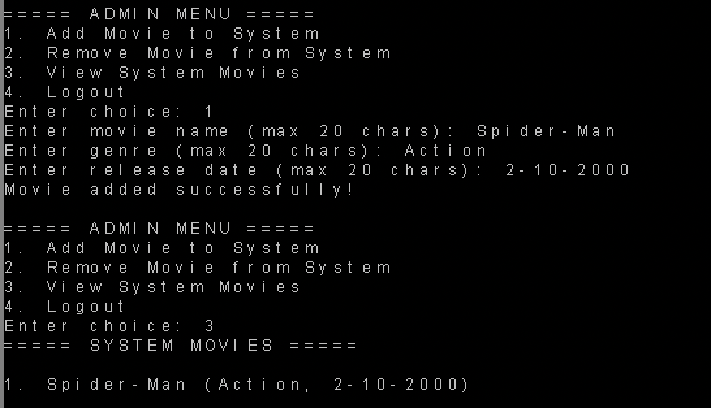

## Features

### 1. Registration and login
- Register with a username and password (up to 15 characters each)
- Duplicate usernames are rejected
- Choose a role at registration: Admin or User
- Log in with username and password verification
- Supports up to 5 accounts
- View all registered users along with their roles

### 2. Admin and user views
Each role gets its own menu with its own permissions.

| Admin menu | User menu |
|------------|-----------|
| Add movie to system | Add movie to watchlist |
| Remove movie from system | Remove movie from watchlist |
| View system movies | Mark movie status |
| Logout | View my watchlist |
| | View system movies |
| | Logout |

Admins control the movie catalog. Users can only change their own watchlist,
not the system.

### 3. Movie catalog and watchlists
- Each movie has a **name**, **genre**, and **release date** (up to 20 characters each)
- The system catalog holds up to 10 movies, and each user's watchlist holds up to 10
- Users can only add movies that an admin has added to the system
- Duplicate movies are rejected in both the catalog and the watchlists
- Removing a movie shifts the remaining entries up, so the list stays in order

### 4. Movie status
Users can mark each movie on their watchlist as **Watched**, **Planned to
Watch**, or **Dropped**. The status is shown next to the movie when viewing
the watchlist.

## Implementation

- **Memory model:** `.MODEL SMALL`, with all data in fixed-size arrays in the data segment
- **Input and output:** DOS interrupt `INT 21h`, using function `01h` to read a character, `09h` to print a `$`-terminated string, and `4Ch` to exit
- **Data layout:**

| Data | Layout |
|------|--------|
| Users | 5 usernames and 5 passwords of 16 bytes each, plus 1 role byte per user |
| System catalog | 10 movie records of 63 bytes (3 fields × 21 bytes) |
| Watchlists | 5 users × 10 entries × 64 bytes (a copy of the 63-byte movie record + 1 status byte: `W`, `P`, or `D`) |

- **Procedures:**

| Procedure | Purpose |
|-----------|---------|
| `READ_STRING`, `READ_STRING_MOVIE` | Read variable-length keyboard input into a buffer |
| `FIND_USER_BY_NAME`, `VERIFY_USER_PASSWORD` | Look up a user and check the password at login |
| `COMPARE_STRINGS`, `COPY_STRING` | String comparison and copying |
| `FIND_MOVIE_IN_LIST`, `FIND_MOVIE_IN_WATCHLIST` | Search the catalog or a user's watchlist |
| `DISPLAY_MOVIE_LIST`, `DISPLAY_MOVIE_LIST_WATCHLIST` | Print the catalog, or a watchlist with statuses |
| `REMOVE_MOVIE`, `REMOVE_MOVIE_WATCHLIST` | Remove an entry and shift the rest of the list |

## How to run

1. Open [`Movie_Watchlist.asm`](Movie_Watchlist.asm) in an 8086 emulator such as **EMU8086**.
2. Click **Emulate**, then **Run**.
3. Register an Admin account and add some movies, then register a User account to build a watchlist.

## Screenshots

### Registration

| Admin registration | User registration |
|--------------------|-------------------|
| 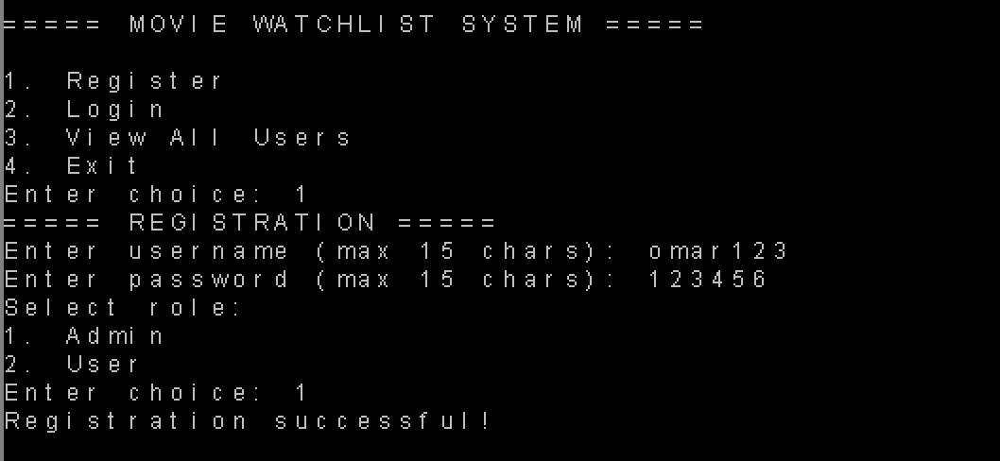 | 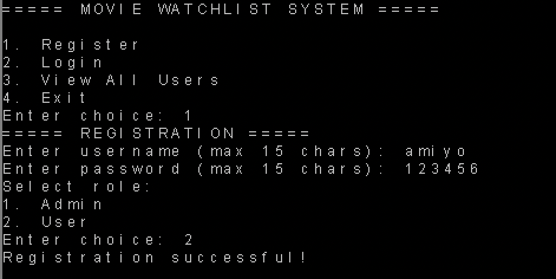 |

### Admin view

**Login and admin menu**

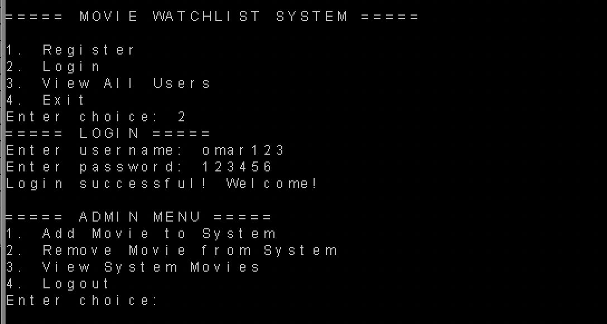

**Adding a movie to the system and viewing the catalog**

**Removing a movie from the system**

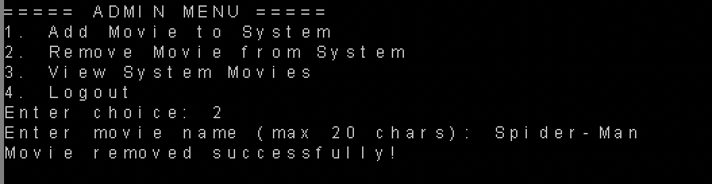

### User view

**Login and user menu**

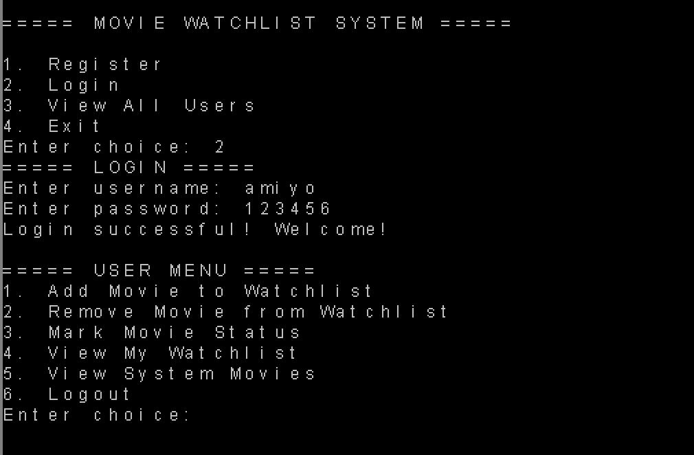

**Adding a movie to the watchlist**

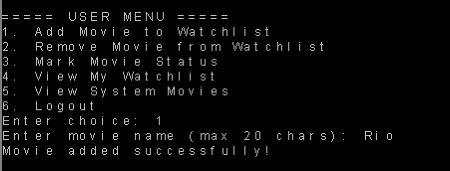

**Viewing the watchlist**

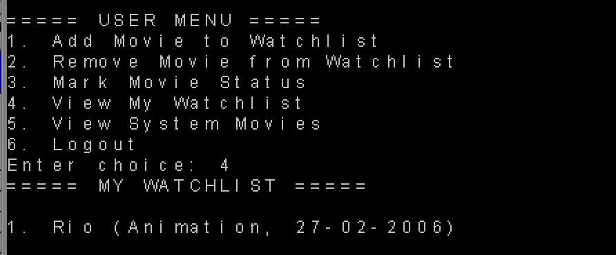

**Marking a movie's status**

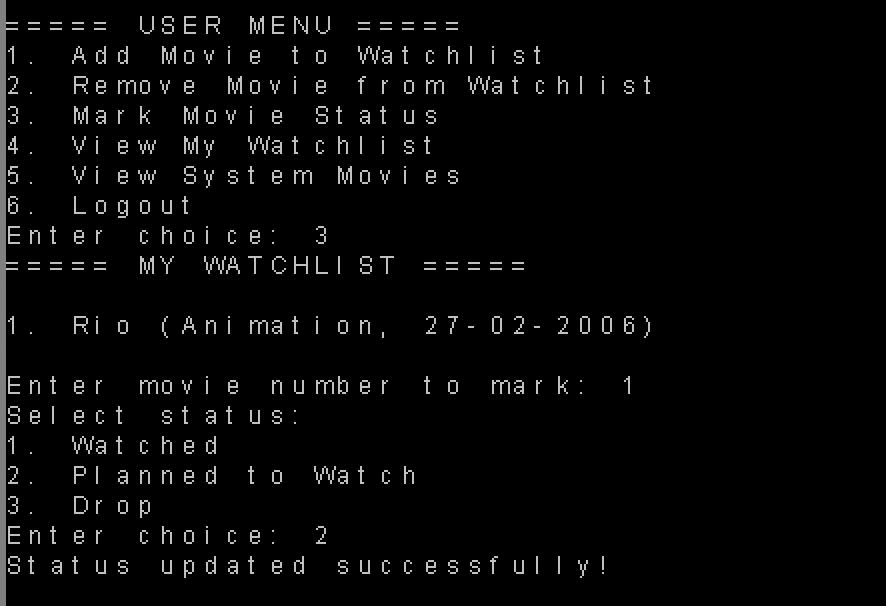

**Watchlist after marking the movie as Planned**

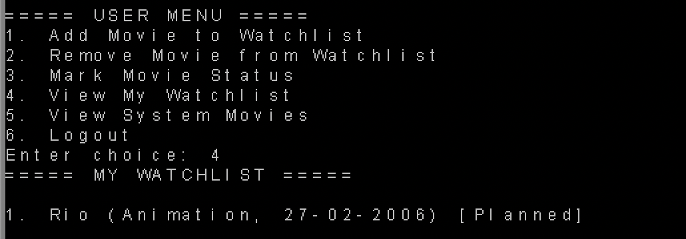

**Removing a movie from the watchlist**

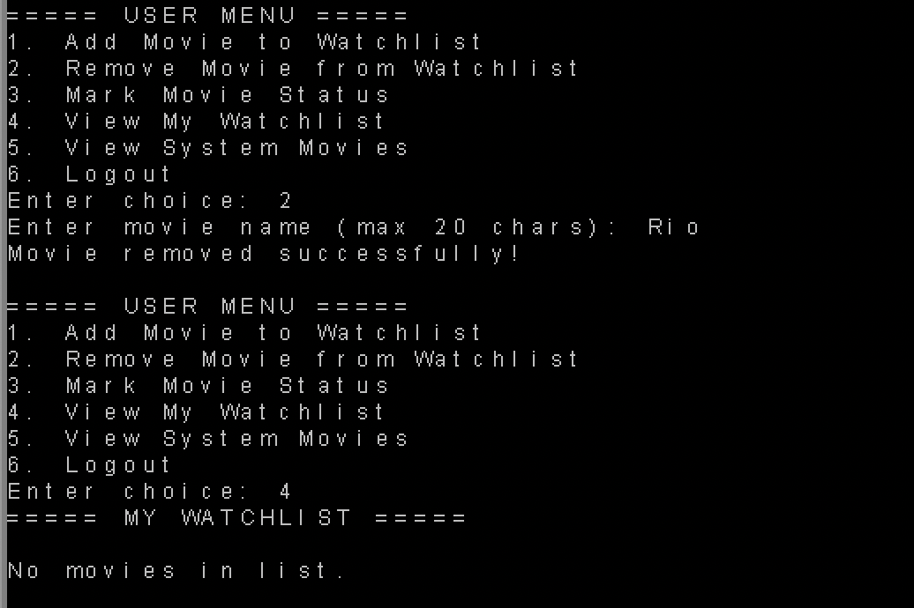

## Limitations

- Data is kept in memory only, so everything is lost when the program exits.
- Passwords are stored as plain text and shown on screen while typing.
- Fixed limits: 5 accounts, 10 system movies, and 10 movies per watchlist.
- When marking a status, the movie number is read as a single digit, so only entries 1–9 can be selected.

## Project specification

The required features are in [docs/project_features.pdf](docs/project_features.pdf).
